# 🍡 Project Architecture & API Reference

> Automatically generated architecture graph and API specification.
> **Modules**: 122 | **Total Symbols**: 975

## 🏗️ Architecture Diagram

```mermaid
graph TD;
  src_acp_test_ts["src/acp.test.ts (1 symbols)"]
  src_acp_ts["src/acp.ts (11 symbols)"]
  src_ambient_ts["src/ambient.ts (8 symbols)"]
  src_autopsy_ts["src/autopsy.ts (8 symbols)"]
  src_background_tasks_test_ts["src/background-tasks.test.ts (1 symbols)"]
  src_background_tasks_ts["src/background-tasks.ts (7 symbols)"]
  src_budget_ts["src/budget.ts (16 symbols)"]
  src_checkpoint_manager_ts["src/checkpoint-manager.ts (7 symbols)"]
  src_circle_ts["src/circle.ts (7 symbols)"]
  src_clarify_ts["src/clarify.ts (11 symbols)"]
  src_cli_ts["src/cli.ts (11 symbols)"]
  src_codebase_sql_test_ts["src/codebase-sql.test.ts (1 symbols)"]
  src_codebase_sql_ts["src/codebase-sql.ts (1 symbols)"]
  src_codegraph_ts["src/codegraph.ts (33 symbols)"]
  src_config_ts["src/config.ts (8 symbols)"]
```

## 📦 Modules & API Reference

### `src/acp.test.ts`
| Line | Kind | Signature |
| :--- | :--- | :--- |
| 5 | `function` | `function freshSessions(): Map<string, AcpSession>` |

### `src/acp.ts`
| Line | Kind | Signature |
| :--- | :--- | :--- |
| 52 | `interface` | `export interface AcpSession` |
| 64 | `interface` | `export interface RpcCall` |
| 70 | `interface` | `export interface RpcResponse` |
| 78 | `function` | `function promptText(prompt: unknown): string` |
| 95 | `type` | `export type AcpNotify` |
| 98 | `function` | `function toolKind(toolName: string): string` |
| 110 | `function` | `export async function handleRpc(` |
| 158 | `function` | `const genMessageId = () => ...` |
| 160 | `function` | `const handleEvent = (e: MochiEvent) => ...` |
| 340 | `function` | `export async function serverLoop(cwd: string): Promise<void>` |
| 343 | `function` | `const send = (msg: unknown) => ...` |

### `src/ambient.ts`
| Line | Kind | Signature |
| :--- | :--- | :--- |
| 10 | `interface` | `export interface AmbientOpts` |
| 20 | `interface` | `export interface AmbientReport` |
| 31 | `function` | `function run(cmd: string, cwd: string, timeoutMs: number): Promise<` |
| 41 | `function` | `export async function checkOnce(opts: AmbientOpts): Promise<AmbientReport[]>` |
| 58 | `function` | `export function detectCommands(cwd: string): string[]` |
| 71 | `function` | `function writeProposal(cwd: string, report: AmbientReport): string` |
| 98 | `function` | `export async function startAmbient(opts: AmbientOpts): Promise<() => void>` |
| 102 | `function` | `const tick = async () => ...` |

### `src/autopsy.ts`
| Line | Kind | Signature |
| :--- | :--- | :--- |
| 13 | `interface` | `export interface DebugAttempt` |
| 26 | `interface` | `export interface Autopsy` |
| 42 | `function` | `function autopsyDir(workspaceDir: string): string` |
| 49 | `function` | `function autopsyPath(workspaceDir: string, taskId: string): string` |
| 58 | `function` | `export function loadOrCreateAutopsy(` |
| 85 | `function` | `export function appendAttempt(` |
| 97 | `function` | `export function finalizeAutopsy(` |
| 109 | `function` | `export function autopsyOneLine(a: Autopsy): string` |

### `src/background-tasks.test.ts`
| Line | Kind | Signature |
| :--- | :--- | :--- |
| 8 | `function` | `function sleep(ms: number)` |

### `src/background-tasks.ts`
| Line | Kind | Signature |
| :--- | :--- | :--- |
| 12 | `interface` | `export interface BackgroundTask` |
| 27 | `function` | `function prune()` |
| 37 | `function` | `export function startBackgroundTask(` |
| 95 | `function` | `export function killTask(id: string): boolean` |
| 117 | `function` | `export function getTask(id: string): BackgroundTask \| undefined` |
| 121 | `function` | `export function listTasks(): BackgroundTask[]` |
| 126 | `function` | `export function describeTask(t: BackgroundTask, maxOutput = 1500): string` |

### `src/budget.ts`
| Line | Kind | Signature |
| :--- | :--- | :--- |
| 3 | `interface` | `export interface BudgetLimits` |
| 12 | `type` | `export type BudgetPhase` |
| 14 | `interface` | `export interface BudgetSnapshot` |
| 54 | `function` | `export function estimateCostUsd(tokens: number \|` |
| 78 | `class` | `export class BudgetEngine` |
| 131 | `method` | `remainingTokens(): number` |
| 135 | `method` | `remainingCostUsd(): number` |
| 139 | `method` | `remainingDurationMs(): number` |
| 144 | `method` | `ratio(): number` |
| 175 | `method` | `phase(): BudgetPhase` |
| 186 | `method` | `phaseCode(): number` |
| 195 | `method` | `snapshot(_model: string): BudgetSnapshot` |
| 215 | `method` | `canUseTokens(tokens: number): boolean` |
| 219 | `method` | `canMakeModelCall(): boolean` |
| 225 | `method` | `canExecuteTool(): boolean` |
| 229 | `method` | `shouldUseCheaperModel(): boolean` |

### `src/checkpoint-manager.ts`
| Line | Kind | Signature |
| :--- | :--- | :--- |
| 9 | `interface` | `export interface NamedCheckpoint` |
| 18 | `function` | `function getCheckpointsDir(cwd: string): string` |
| 24 | `function` | `function runGit(cwd: string, args: string[]): string` |
| 30 | `function` | `export async function saveNamedCheckpoint(` |
| 62 | `function` | `export function listNamedCheckpoints(cwd: string): NamedCheckpoint[]` |
| 81 | `function` | `export async function restoreNamedCheckpoint(` |
| 122 | `function` | `export function deleteNamedCheckpoint(cwd: string, name: string): boolean` |

### `src/circle.ts`
| Line | Kind | Signature |
| :--- | :--- | :--- |
| 18 | `interface` | `export interface CircleVerdict` |
| 33 | `function` | `function openingPrefix(text: string): string` |
| 38 | `function` | `function shingleSet(text: string, k = 3): Set<string>` |
| 47 | `function` | `function jaccard(a: Set<string>, b: Set<string>): number` |
| 54 | `function` | `function isQuestionOnly(text: string): boolean` |
| 63 | `function` | `function isListOnly(text: string): boolean` |
| 71 | `function` | `export function detectCircle(messages: ChatMessage[], windowSize = 4): CircleVerdict` |

### `src/clarify.ts`
| Line | Kind | Signature |
| :--- | :--- | :--- |
| 9 | `interface` | `export interface Choice` |
| 16 | `interface` | `export interface ClarifyQuestion` |
| 22 | `interface` | `export interface Renderer` |
| 23 | `method` | `render(q: ClarifyQuestion): string;` |
| 24 | `method` | `receive(): Promise<string>;` |
| 28 | `function` | `export function renderMenu(q: ClarifyQuestion): string` |
| 42 | `function` | `export function resolveChoice(q: ClarifyQuestion, raw: string \| null): MenuOutcome` |
| 60 | `interface` | `export interface MenuOutcome` |
| 67 | `function` | `export async function askUserChoice(` |
| 77 | `function` | `export function defaultRenderer(): Renderer` |
| 84 | `method` | `async receive()` |

### `src/cli.ts`
| Line | Kind | Signature |
| :--- | :--- | :--- |
| 39 | `function` | `function logCrash(kind: string, err: unknown): void` |
| 90 | `function` | `function parseArgs(argv: string[]):` |
| 122 | `function` | `function configFromFlags(flags: Record<string, string \| boolean>): Partial<MochiConfig>` |
| 172 | `function` | `function printHelp()` |
| 251 | `function` | `function cliDirname(): string` |
| 256 | `function` | `function srcFileNewer(dir: string, mtime: number): boolean` |
| 273 | `function` | `async function main()` |
| 453 | `function` | `const post = async (action2: string, extra: Record<string, unknown> = {}) => ...` |
| 1335 | `function` | `const onData = (c: Buffer) => ...` |
| 1454 | `function` | `const files = (() => ...` |
| 1513 | `function` | `async function interactive(runtime: import('./runtime.js').Runtime, initialPrompt?: string)` |

### `src/codebase-sql.test.ts`
| Line | Kind | Signature |
| :--- | :--- | :--- |
| 11 | `function` | `const ctx = () => ...` |

### `src/codebase-sql.ts`
| Line | Kind | Signature |
| :--- | :--- | :--- |
| 18 | `method` | `async execute(args, ctx)` |

### `src/codegraph.ts`
| Line | Kind | Signature |
| :--- | :--- | :--- |
| 13 | `function` | `function tsc(): typeof import('typescript')` |
| 22 | `function` | `export function hasSqlite(): boolean` |
| 37 | `type` | `export type LanguageId` |
| 98 | `function` | `function heritage(node: ts.ClassLikeDeclaration \| ts.InterfaceDeclaration): string[]` |
| 111 | `function` | `function indexFile(file: string, rel: string, database: SqliteDb): void` |
| 115 | `function` | `const lineOf = (p: number) => ...` |
| 118 | `function` | `const emit = (name: string, kind: string, start: number, body: string) => ...` |
| 123 | `function` | `function visit(node: ts.Node): void` |
| 155 | `type` | `export type ParserBackend` |
| 194 | `function` | `function nameOf(node: any): string \| undefined` |
| 221 | `function` | `export function isLightMode(): boolean` |
| 226 | `function` | `function treeSitterAvailable(): boolean` |
| 240 | `function` | `async function ensureCore(): Promise<boolean>` |
| 264 | `function` | `export async function ensureLanguage(lang: LanguageId \| string): Promise<boolean>` |
| 299 | `function` | `async function preloadGrammars(cwd: string, langs?: readonly string[]): Promise<void>` |
| 332 | `function` | `export function loadTreeSitter():` |
| 343 | `function` | `export function getParserBackend(): ParserBackend` |
| 354 | `function` | `export async function ensureParserLoaded(): Promise<void>` |
| 356 | `function` | `function namedChildren(node: any): any[]` |
| 369 | `function` | `function tsIndexFile(file: string, rel: string, database: SqliteDb): void` |
| 412 | `function` | `function callName(node: any): string \| undefined` |
| 431 | `interface` | `interface CachedDb` |
| 438 | `function` | `function fingerprint(full: string): string` |
| 447 | `function` | `function db(cwd: string): SqliteDb` |
| 496 | `function` | `export async function getFunctionSynapse(cwd: string, name: string): Promise<string>` |
| 507 | `function` | `export async function findCallers(cwd: string, name: string): Promise<string>` |
| 553 | `function` | `export async function typeHierarchy(cwd: string, name: string): Promise<string>` |
| 566 | `interface` | `export interface BlastRadiusReport` |
| 579 | `function` | `export async function computeSymbolBlastRadius(cwd: string, name: string): Promise<BlastRadiusReport>` |
| 620 | `interface` | `interface Sym` |
| 626 | `function` | `export function querySymbolGraph(cwd: string, sql: string, maxRows = 50): Promise<` |
| 638 | `function` | `export function querySymbolGraphSync(cwd: string, sql: string, maxRows = 50):` |
| 659 | `function` | `export async function warmCodegraph(cwd: string, langs?: readonly string[]): Promise<void>` |

### `src/config.ts`
| Line | Kind | Signature |
| :--- | :--- | :--- |
| 52 | `function` | `function readJsonFile(path: string): Record<string, unknown> \| undefined` |
| 61 | `function` | `function envModelConfig(): Partial<MochiConfig['model']>` |
| 80 | `function` | `export function loadEnvFiles(): void` |
| 110 | `function` | `export function loadConfig(overrides: Partial<MochiConfig> =` |
| 131 | `function` | `function isPlaceholderKey(key: string \| undefined): boolean` |
| 249 | `function` | `function merge(target: Record<string, unknown>, source: Record<string, unknown>)` |
| 264 | `function` | `export function loadProjectConfig(projectDir: string): Partial<MochiConfig>` |
| 274 | `function` | `export function validateConfig(config: MochiConfig): string[]` |

### `src/consolidate.test.ts`
| Line | Kind | Signature |
| :--- | :--- | :--- |
| 9 | `function` | `function failedTask(over: Partial<Task> =` |
| 28 | `function` | `function failedResult(failed: Task[]): GoalResult` |

### `src/consolidate.ts`
| Line | Kind | Signature |
| :--- | :--- | :--- |
| 26 | `function` | `function failureReason(task: Task): string` |
| 37 | `interface` | `export interface ConsolidationResult` |
| 43 | `function` | `export function consolidate(workspaceDir: string, result: GoalResult, model = 'mochi'): ConsolidationResult` |
| 68 | `function` | `export function consolidateReason(task: Pick<Task, 'attempts' \| 'output'>): string` |

### `src/context-compaction-fidelity.test.ts`
| Line | Kind | Signature |
| :--- | :--- | :--- |
| 14 | `function` | `function makeConfig(dir: string): MochiConfig` |

### `src/context.freshness.test.ts`
| Line | Kind | Signature |
| :--- | :--- | :--- |
| 12 | `function` | `function toolCall(name: string, args: Record<string, unknown>)` |

### `src/context.skills-relevance.test.ts`
| Line | Kind | Signature |
| :--- | :--- | :--- |
| 5 | `function` | `function skill(name: string, description: string): Skill` |

### `src/context.test.ts`
| Line | Kind | Signature |
| :--- | :--- | :--- |
| 15 | `function` | `function makeEngine(dir: string, overrides: Partial<MochiConfig> =` |
| 20 | `function` | `function cfg(): MochiConfig` |
| 70 | `function` | `const task = (title: string, description = '') => ...` |
| 155 | `function` | `const mk = (name: string) => ...` |

### `src/context.ts`
| Line | Kind | Signature |
| :--- | :--- | :--- |
| 32 | `function` | `function countFilesShallow(root: string): number` |
| 34 | `function` | `const visit = (dir: string, depth: number) => ...` |
| 58 | `function` | `export function clearMachineBlockCache(): void` |
| 62 | `function` | `export function machineAccessBlock(projectRoot?: string): string` |
| 67 | `function` | `const os = (() => ...` |
| 70 | `function` | `const mem = (() => ...` |
| 77 | `function` | `const cpu = (() => ...` |
| 84 | `function` | `const host = (() => ...` |
| 113 | `function` | `function fingerprint(path: string): string` |
| 123 | `function` | `function rulesSource(path: string, label: string): string` |
| 127 | `function` | `export function approxTokens(text: string): number` |
| 156 | `function` | `export function tokenOverlap(a: string, b: string): number` |
| 157 | `function` | `const tok = (s: string) => ...` |
| 175 | `function` | `export function selectRelevantSkills(skills: Skill[], taskText: string, max: number, usageBoost?: Map<string, number>): Skill[]` |
| 193 | `interface` | `export interface ContextState` |
| 207 | `interface` | `export interface ContextPacket` |
| 214 | `class` | `export class ContextEngine` |
| 309 | `method` | `getMessages(): readonly ChatMessage[]` |
| 315 | `method` | `estimateTokens(): number` |
| 326 | `method` | `async estimateTokensAsync(): Promise<number>` |
| 335 | `method` | `private loadMemory(query = ''): string` |
| 365 | `method` | `private loadProjectRules(task?: Task): string` |
| 405 | `method` | `private skills(task?: Task, tools?: ToolDefinition[]): string` |
| 446 | `method` | `private buildSystemPrompt(tools: ToolDefinition[], repo?: RepoInfo, task?: Task): string` |
| 507 | `method` | `private toolGuidelines(tools: ToolDefinition[]): string` |
| 510 | `function` | `const add = (names: string[], text: string) => ...` |
| 541 | `method` | `private buildVolatilePrompt(task?: Task): string` |
| 608 | `method` | `private tinyWorkspaceLine(): string \| null` |
| 629 | `method` | `private buildStatePrompt(task?: Task): string` |
| 664 | `method` | `buildPacket(tools: ToolDefinition[], task?: Task, repo?: RepoInfo): ContextPacket` |
| 773 | `method` | `private trackFileOp(message: ChatMessage)` |
| 803 | `method` | `detectStaleFiles(): string[]` |
| 818 | `method` | `stalenessWarning(): string` |
| 838 | `method` | `effectiveContextTokens(): number` |
| 855 | `method` | `shrinkOldToolOutputs(): number` |
| 881 | `method` | `private stateLedger(): string` |
| 922 | `method` | `async previewCompact(): Promise<ChatMessage[] \| null>` |
| 928 | `method` | `async compact(checkpoint?: string)` |

### `src/contract.ts`
| Line | Kind | Signature |
| :--- | :--- | :--- |
| 15 | `function` | `export function findRulesFile(cwd: string): string \| null` |
| 24 | `function` | `export function loadRules(cwd: string): string` |
| 34 | `function` | `export function contractSection(cwd: string): string` |
| 42 | `function` | `export function appendRule(cwd: string, rule: string):` |
| 54 | `function` | `export function writeRules(cwd: string, body: string):` |
| 61 | `function` | `export function listRules(cwd: string): string[]` |

### `src/cron.test.ts`
| Line | Kind | Signature |
| :--- | :--- | :--- |
| 10 | `function` | `const tmp = () => ...` |

### `src/cron.ts`
| Line | Kind | Signature |
| :--- | :--- | :--- |
| 13 | `interface` | `export interface CronJob` |
| 30 | `function` | `export function everyInterval(spec: string): number \| null` |
| 41 | `function` | `function fieldSet(v: string): number[]` |
| 57 | `function` | `function nextCron(fields: string[], from: number): number \| null` |
| 73 | `function` | `function matches(d: Date, mins: number[], hours: number[], doms: number[], mons: number[], dows: number[]): boolean` |
| 84 | `function` | `export function nextRunFor(spec: string, from = Date.now()): number \| null` |
| 92 | `function` | `export function isRunnable(spec: string): boolean` |
| 97 | `function` | `export function bumpJob(job: CronJob): CronJob` |
| 103 | `function` | `function loadJobs(dir: string): CronJob[]` |
| 136 | `function` | `function saveJobs(dir: string, jobs: CronJob[]): void` |
| 147 | `function` | `export function validateNotify(notify: string): string \| null` |
| 166 | `function` | `export function addJob(dir: string, prompt: string, schedule: string, notify?: string):` |
| 196 | `function` | `export async function notifyJobResult(job: CronJob, summary: string): Promise<void>` |
| 239 | `function` | `export function jobNotify(job: CronJob): string \| null` |
| 243 | `function` | `export function removeJob(dir: string, id: string): boolean` |
| 249 | `function` | `export function updateJob(dir: string, job: CronJob): void` |
| 254 | `function` | `export function listJobs(dir: string): CronJob[]` |
| 259 | `function` | `export function dueJobs(dir: string, now = Date.now()): CronJob[]` |

### `src/curate-auto-skills.test.ts`
| Line | Kind | Signature |
| :--- | :--- | :--- |
| 10 | `function` | `function writeAuto(name: string, body = 'test skill body'): void` |

### `src/daemon.live.test.ts`
| Line | Kind | Signature |
| :--- | :--- | :--- |
| 24 | `function` | `function makeConfig(): MochiConfig` |
| 48 | `function` | `function api(port: number, token: string, path: string, body?: unknown)` |

### `src/daemon.test.ts`
| Line | Kind | Signature |
| :--- | :--- | :--- |
| 9 | `function` | `async function retryUntil<T>(fn: () => T \| undefined, timeout: number): Promise<T>` |

### `src/daemon.ts`
| Line | Kind | Signature |
| :--- | :--- | :--- |
| 20 | `interface` | `export interface DaemonInfo` |
| 29 | `function` | `export function daemonInfoPath(workspaceDir: string): string` |
| 33 | `function` | `export function readDaemonInfo(workspaceDir: string): DaemonInfo \| undefined` |
| 43 | `function` | `function pidAlive(pid: number): boolean` |
| 53 | `function` | `function timingSafeEqualStr(a: string, b: string): boolean` |
| 61 | `function` | `export function daemonRunning(workspaceDir: string): boolean` |
| 66 | `function` | `function writeInfo(workspaceDir: string, info: DaemonInfo): void` |
| 81 | `function` | `export async function startDaemon(opts:` |
| 114 | `function` | `export async function startDaemonInProcess(opts:` |
| 143 | `function` | `const runDue = async () => ...` |
| 176 | `function` | `function getDashboardHtml(token: string): string` |
| 268 | `function` | `async function sendGoal()` |
| 316 | `function` | `function sendQuick(cmd)` |
| 321 | `function` | `function addMsg(text, type)` |
| 335 | `function` | `async function handleRequest(` |
| 341 | `function` | `const send = (code: number, body: unknown) => ...` |
| 470 | `function` | `const sse = (event: string, data: unknown) => ...` |
| 476 | `function` | `const onAbort = () => ...` |
| 507 | `function` | `export async function serverMain(argv: string[]): Promise<void>` |

### `src/diagnosis.ts`
| Line | Kind | Signature |
| :--- | :--- | :--- |
| 8 | `type` | `export type FailureKind` |
| 18 | `interface` | `export interface Hypothesis` |
| 26 | `interface` | `export interface DiagnosisResult` |
| 34 | `function` | `export function classifyFailure(failureText: string):` |
| 65 | `function` | `export function rankHypotheses(h: Hypothesis[]): Hypothesis[]` |
| 76 | `function` | `export function syntaxProbe(file: string): string \| undefined` |
| 96 | `function` | `export function typeProbe(file: string): string \| undefined` |
| 115 | `function` | `export function formInitialHypotheses(` |
| 120 | `function` | `const base = (file: string \| undefined) => ...` |
| 176 | `function` | `export function evaluateProbe(` |
| 192 | `function` | `export function diagnosisToPrompt(diag: DiagnosisResult): string` |

### `src/diagnostics.test.ts`
| Line | Kind | Signature |
| :--- | :--- | :--- |
| 8 | `function` | `function tsProject()` |
| 57 | `method` | `writeFileSync(good, 'def fine():\n    return 1\n');` |

### `src/diagnostics.ts`
| Line | Kind | Signature |
| :--- | :--- | :--- |
| 18 | `interface` | `export interface FileDiagnostics` |
| 29 | `function` | `function cap(lines: string[]): string[]` |
| 35 | `interface` | `interface TsService` |
| 43 | `function` | `function getTsService(root: string): TsService \| undefined` |
| 87 | `function` | `async function diagnoseTsViaCli(path: string, cwd: string): Promise<FileDiagnostics>` |
| 96 | `function` | `function diagnoseTs(path: string, root: string): FileDiagnostics` |
| 120 | `function` | `function exec(cmd: string, args: string[], cwd: string, timeout: number): Promise<` |
| 133 | `function` | `async function diagnosePython(path: string, cwd: string): Promise<FileDiagnostics>` |
| 144 | `function` | `export async function diagnoseFile(path: string, cwd: string): Promise<FileDiagnostics>` |
| 188 | `function` | `export function renderDiagnostics(diags: FileDiagnostics[]): string` |

### `src/discord.ts`
| Line | Kind | Signature |
| :--- | :--- | :--- |
| 10 | `interface` | `export interface DiscordConfig` |
| 19 | `function` | `export function loadDiscordConfig(cwd: string): DiscordConfig \| null` |
| 61 | `function` | `export async function sendDiscordMessage(` |
| 89 | `function` | `export async function handleDiscordMessage(` |

### `src/docgen.ts`
| Line | Kind | Signature |
| :--- | :--- | :--- |
| 9 | `interface` | `export interface ModuleDoc` |
| 15 | `interface` | `export interface ProjectDocs` |
| 27 | `function` | `function scanSourceFiles(dir: string, maxFiles = 100): string[]` |
| 57 | `function` | `function extractImports(content: string): string[]` |
| 72 | `function` | `export function generateProjectDocs(cwd: string, opts:` |

### `src/doctor.test.ts`
| Line | Kind | Signature |
| :--- | :--- | :--- |
| 11 | `function` | `function tmp(): string` |

### `src/doctor.ts`
| Line | Kind | Signature |
| :--- | :--- | :--- |
| 13 | `interface` | `export interface SkillHealthEntry` |
| 19 | `interface` | `export interface DoctorReport` |
| 40 | `function` | `export async function doctorReport(opts:` |
| 56 | `function` | `const tsAvailable = (() => ...` |
| 83 | `function` | `const checkFile = (skillPath: string, name: string) => ...` |
| 89 | `function` | `const size = (() => ...` |
| 100 | `function` | `const walk = (dir: string) => ...` |
| 178 | `function` | `export function formatDoctor(r: DoctorReport): string` |
| 179 | `function` | `const ok = (b: boolean) => ...` |
| 200 | `interface` | `export interface RepairItem` |
| 207 | `function` | `export async function repairDoctor(opts:` |

### `src/dox.ts`
| Line | Kind | Signature |
| :--- | :--- | :--- |
| 11 | `interface` | `export interface DocChunk` |
| 22 | `function` | `export function indexDocs(root: string, maxChunks = 400): DocChunk[]` |
| 64 | `function` | `export function queryDocs(root: string, query: string, limit = 5): DocChunk[]` |
| 82 | `interface` | `export interface AdrInput` |
| 92 | `function` | `export function nextAdrNumber(adrDir: string): number` |
| 103 | `function` | `export function generateAdr(root: string, input: AdrInput): string` |

### `src/esm-hygiene.test.ts`
| Line | Kind | Signature |
| :--- | :--- | :--- |
| 16 | `function` | `function listTsFiles(dir: string, acc: string[] = []): string[]` |
| 30 | `function` | `function stripComments(src: string): string` |

### `src/events.test.ts`
| Line | Kind | Signature |
| :--- | :--- | :--- |
| 37 | `function` | `const trap = (p: Promise<unknown>) => ...` |
| 39 | `function` | `const rejectingHandler = () => ...` |
| 48 | `function` | `const onUnhandled = (e: { reason?: unknown }) => ...` |

### `src/events.ts`
| Line | Kind | Signature |
| :--- | :--- | :--- |
| 6 | `interface` | `export interface EventBusStats` |
| 27 | `class` | `export class EventBus` |
| 65 | `method` | `snapshot(): readonly MochiEvent[]` |
| 69 | `method` | `stats(): EventBusStats` |
| 76 | `method` | `private fanout(event: MochiEvent, record = true): void` |
| 92 | `method` | `private invoke(h: (event: MochiEvent) => void \| Promise<void>, event: MochiEvent): void` |
| 104 | `method` | `emit(event: MochiEvent): void` |
| 110 | `method` | `emitNow(event: MochiEvent): void` |
| 116 | `method` | `flush(): void` |
| 124 | `method` | `async emitAwait(event: MochiEvent): Promise<void>` |
| 144 | `method` | `private stamp(event: MochiEvent): void` |

### `src/fast-events.ts`
| Line | Kind | Signature |
| :--- | :--- | :--- |
| 3 | `type` | `type Handler` |
| 5 | `interface` | `export interface EventBusStats` |
| 13 | `class` | `export class FastEventBus` |
| 26 | `method` | `on(type: CompactEvent['type'] \| '*', handler: Handler): () => void` |
| 45 | `method` | `emit(event: CompactEvent): void` |
| 66 | `method` | `flush(): void` |
| 77 | `method` | `private dispatch(event: CompactEvent, updateStats = true): void` |
| 87 | `method` | `private updateStats(count: number, elapsed: number): void` |
| 95 | `method` | `getStats(): EventBusStats` |

### `src/feedback.ts`
| Line | Kind | Signature |
| :--- | :--- | :--- |
| 21 | `type` | `export type FeedbackVerdict` |
| 23 | `interface` | `export interface FeedbackEntry` |
| 35 | `function` | `function ensureFile(): void` |
| 40 | `function` | `export function recordFeedback(entry: FeedbackEntry): void` |
| 45 | `function` | `export function loadAllFeedback(): FeedbackEntry[]` |
| 58 | `function` | `export function recentFeedback(n = 10): FeedbackEntry[]` |
| 64 | `function` | `export function recentBad(n = 5): FeedbackEntry[]` |
| 71 | `function` | `export function feedbackDigest(): string` |
| 101 | `function` | `export function feedbackPulse(): string` |

### `src/git.test.ts`
| Line | Kind | Signature |
| :--- | :--- | :--- |
| 14 | `function` | `function makeRepo(): string` |
| 21 | `function` | `function dirty(cwd: string): boolean` |

### `src/git.ts`
| Line | Kind | Signature |
| :--- | :--- | :--- |
| 4 | `function` | `function run(cwd: string, args: string[]): Promise<string>` |
| 19 | `function` | `export async function isRepo(cwd: string): Promise<boolean>` |
| 28 | `function` | `export async function status(cwd: string): Promise<string>` |
| 33 | `function` | `export async function diff(cwd: string): Promise<string>` |
| 52 | `function` | `export async function log(cwd: string, n = 10): Promise<string>` |
| 57 | `interface` | `export interface CheckpointResult` |
| 63 | `function` | `export async function checkpoint(cwd: string, message = 'mochi checkpoint'): Promise<CheckpointResult>` |
| 82 | `function` | `export async function restore(cwd: string, checkpoint: CheckpointResult): Promise<string>` |
| 102 | `function` | `export async function preEditSnapshot(cwd: string, message = 'mochi pre-edit', stateDir = '.mochi'): Promise<CheckpointResult \| null>` |
| 124 | `function` | `export async function rollbackToSnapshot(cwd: string, cp: CheckpointResult, stateDir = '.mochi'): Promise<string>` |

### `src/hooks.ts`
| Line | Kind | Signature |
| :--- | :--- | :--- |
| 5 | `type` | `export type HookName` |
| 24 | `interface` | `export interface HookConfig` |
| 28 | `interface` | `export interface HookResult` |
| 35 | `class` | `export class HookManager` |
| 58 | `method` | `list(): HookName[]` |
| 62 | `method` | `enabled(name: HookName): boolean` |
| 66 | `method` | `private commandsFor(name: HookName): string[]` |
| 73 | `method` | `async runBefore(name: HookName, context: Record<string, string> =` |
| 85 | `method` | `async runAfter(name: HookName, context: Record<string, string> =` |

### `src/kv-cache.ts`
| Line | Kind | Signature |
| :--- | :--- | :--- |
| 9 | `type` | `export type CacheState` |
| 11 | `interface` | `export interface CacheStatus` |
| 28 | `class` | `export class KvCacheTracker` |
| 33 | `method` | `get lastCacheSaved(): number` |
| 35 | `method` | `get totalCacheSaved(): number` |
| 55 | `method` | `recordCacheHit(savedTokens: number): void` |
| 61 | `method` | `status(): CacheStatus` |
| 89 | `method` | `badge(): string` |
| 95 | `method` | `reset(): void` |

### `src/learning.ts`
| Line | Kind | Signature |
| :--- | :--- | :--- |
| 4 | `interface` | `export interface RecoveryRecord` |
| 11 | `interface` | `export interface LearningState` |
| 23 | `function` | `export function classifyFailure(error: string): RecoveryRecord \| undefined` |
| 32 | `class` | `export class LearningStore` |
| 51 | `method` | `private save()` |
| 57 | `method` | `private find(pattern: string, strategy: string): RecoveryRecord \| undefined` |
| 72 | `method` | `successRate(pattern: string, strategy: string): number` |
| 78 | `method` | `bestStrategy(pattern: string): RecoveryRecord \| undefined` |
| 84 | `method` | `knownStrategies(): RecoveryRecord[]` |

### `src/lessons.ts`
| Line | Kind | Signature |
| :--- | :--- | :--- |
| 13 | `interface` | `export interface Lesson` |
| 27 | `function` | `export function lessonsPath(workspaceDir: string): string` |
| 31 | `function` | `export function loadLessons(workspaceDir: string): Lesson[]` |
| 42 | `function` | `export function saveLessons(workspaceDir: string, lessons: Lesson[]): void` |
| 49 | `function` | `export function recordLesson(workspaceDir: string, lesson: Omit<Lesson, 'useCount' \| 'successCount' \| 'recordedAtMs'>): Lesson[]` |
| 72 | `function` | `export function retrieveLessons(workspaceDir: string, signal: string, kind?: string, limit = 3): Lesson[]` |
| 86 | `function` | `export function markLessonUsed(workspaceDir: string, id: string, succeeded: boolean): void` |
| 97 | `function` | `export function lessonsToPrompt(lessons: Lesson[]): string` |

### `src/memory-store.ts`
| Line | Kind | Signature |
| :--- | :--- | :--- |
| 13 | `interface` | `export interface MemoryFact` |
| 29 | `function` | `function memoryFile(): string` |
| 36 | `function` | `function ensure(): void` |
| 41 | `function` | `function randomId(): string` |
| 45 | `function` | `export function addFact(statement: string, category: MemoryFact['category'] = 'fact', source = 'session'): MemoryFact \| null` |
| 65 | `function` | `export function loadFacts(): MemoryFact[]` |
| 84 | `function` | `export function recordFactAttempt(id: string, success: boolean): void` |
| 107 | `function` | `function noteFactSurfaced(id: string): void` |
| 112 | `function` | `export function takeSurfacedFactIds(): string[]` |
| 120 | `function` | `export function forgetFact(query: string): number` |
| 132 | `function` | `function tokenize(text: string): Set<string>` |
| 141 | `function` | `export function memorySimilarity(a: string, b: string): number` |
| 158 | `function` | `export function recallFacts(context: string, maxFacts = 15): MemoryFact[]` |
| 182 | `function` | `export function decayFacts(maxAgeMs = 60 * 24 * 3600 * 1000): number` |
| 195 | `function` | `export function memoryDigest(taskContext?: string): string` |
| 218 | `function` | `export function memoryPulse(): string` |

### `src/memory.ts`
| Line | Kind | Signature |
| :--- | :--- | :--- |
| 4 | `interface` | `export interface MemoryEntry` |
| 12 | `function` | `function entryToMarkdown(e: MemoryEntry): string` |
| 22 | `class` | `export class MemoryStore` |
| 73 | `method` | `load(kind?: MemoryEntry['kind']): string` |
| 93 | `method` | `entries(kind?: MemoryEntry['kind']): MemoryEntry[]` |
| 120 | `method` | `summary(): string` |

### `src/model-manager.test.ts`
| Line | Kind | Signature |
| :--- | :--- | :--- |
| 26 | `function` | `function base(): MochiConfig` |

### `src/model-manager.ts`
| Line | Kind | Signature |
| :--- | :--- | :--- |
| 4 | `interface` | `export interface ProviderSelection` |
| 11 | `function` | `export function currentConfig(): MochiConfig` |
| 15 | `function` | `export function setProvider(config: MochiConfig, selection: ProviderSelection): MochiConfig` |
| 39 | `function` | `export function login(config: MochiConfig, providerId: string, apiKey: string, model?: string): MochiConfig` |
| 50 | `function` | `export function selectProviderById(config: MochiConfig, providerId: string, model?: string): MochiConfig` |
| 60 | `function` | `export function listProviderIds(): string[]` |
| 64 | `function` | `export function listModelsForProvider(providerId: string): string[]` |
| 69 | `function` | `export function describeConfig(config: MochiConfig): string` |
| 78 | `function` | `export function maskApiKey(key: string): string` |

### `src/model-router.ts`
| Line | Kind | Signature |
| :--- | :--- | :--- |
| 13 | `type` | `export type TaskTier` |
| 17 | `function` | `export function classifyTaskTier(taskTitle: string, taskRole?: string): TaskTier` |
| 34 | `function` | `export function resolveModel(config: ModelConfig, tier: TaskTier): string` |
| 46 | `function` | `async function sleep(ms: number): Promise<void>` |
| 50 | `interface` | `export interface RetryConfig` |
| 62 | `function` | `export async function withFailover<T>(` |

### `src/modes.test.ts`
| Line | Kind | Signature |
| :--- | :--- | :--- |
| 5 | `function` | `const base = () => ...` |

### `src/modes.ts`
| Line | Kind | Signature |
| :--- | :--- | :--- |
| 13 | `type` | `export type AgentMode` |
| 15 | `interface` | `export interface ModeSpec` |
| 75 | `function` | `export function modeSpec(mode: AgentMode): ModeSpec` |
| 79 | `function` | `export function isMode(s: string): s is AgentMode` |
| 84 | `function` | `export function applyMode(config: MochiConfig, mode: AgentMode): MochiConfig` |
| 94 | `function` | `export function modeInstruction(mode: AgentMode): string` |
| 101 | `function` | `export function formatModes(current: AgentMode): string` |

### `src/mutation.test.ts`
| Line | Kind | Signature |
| :--- | :--- | :--- |
| 9 | `function` | `function makeRepo(): string` |

### `src/mutation.ts`
| Line | Kind | Signature |
| :--- | :--- | :--- |
| 23 | `interface` | `export interface MutationCheck` |
| 72 | `function` | `function isTestFile(path: string): boolean` |
| 91 | `function` | `function isInStringOrComment(source: string, idx: number): boolean` |
| 125 | `function` | `export function findMutation(source: string):` |
| 157 | `function` | `export function changedSourceFiles(cwd: string): string[]` |
| 208 | `function` | `export async function runMutationCheck(` |

### `src/one-shot.ts`
| Line | Kind | Signature |
| :--- | :--- | :--- |
| 10 | `interface` | `interface ClassifyInput` |
| 17 | `type` | `export type OneShotKind` |
| 49 | `function` | `export function classifyOneShot(input: ClassifyInput):` |
| 95 | `function` | `export function classifyContentOnly(input: ClassifyInput): boolean` |

### `src/perf.ts`
| Line | Kind | Signature |
| :--- | :--- | :--- |
| 3 | `function` | `function sse(payload: object)` |
| 7 | `interface` | `export interface PerfReport` |
| 18 | `function` | `export function benchmarkStream(chunks = 10_000): PerfReport` |
| 44 | `function` | `export function formatPerfReport(report: PerfReport): string` |
| 45 | `function` | `const pct = (v: number) => ...` |

### `src/performance-pipeline.test.ts`
| Line | Kind | Signature |
| :--- | :--- | :--- |
| 5 | `function` | `function sse(payload: object)` |

### `src/performance-pipeline.ts`
| Line | Kind | Signature |
| :--- | :--- | :--- |
| 8 | `interface` | `export interface PipelineState` |
| 18 | `interface` | `export interface PipelineStats` |
| 26 | `class` | `export class PerformancePipeline` |
| 52 | `method` | `private wire(): void` |
| 69 | `method` | `write(chunk: string): void` |
| 76 | `method` | `end(): void` |
| 81 | `method` | `private emitBatched(events: CompactEvent[]): void` |
| 93 | `method` | `markRegion(region: UIRegion): void` |
| 97 | `method` | `render(): void` |
| 101 | `method` | `getStats(): PipelineStats` |

### `src/permission.ts`
| Line | Kind | Signature |
| :--- | :--- | :--- |
| 13 | `type` | `export type PermissionPolicy` |
| 22 | `function` | `export function detectPolicy(flags: Record<string, string \| boolean>): PermissionPolicy` |
| 44 | `interface` | `export interface PermissionRequest` |
| 51 | `type` | `export type PermissionDecision` |
| 53 | `class` | `export class PermissionManager` |
| 66 | `method` | `get currentPolicy(): PermissionPolicy` |
| 68 | `method` | `setPolicy(p: PermissionPolicy): void` |
| 71 | `method` | `autoAllow(req: PermissionRequest): boolean` |
| 114 | `method` | `badge(): string` |
| 131 | `function` | `export function parsePermissionSlashCommand(` |

### `src/pipeline.test.ts`
| Line | Kind | Signature |
| :--- | :--- | :--- |
| 8 | `function` | `function streamFrom(text: string): Readable` |

### `src/pipeline.ts`
| Line | Kind | Signature |
| :--- | :--- | :--- |
| 12 | `interface` | `export interface ReviewFinding` |
| 23 | `function` | `export async function readStdin(stream: NodeJS.ReadableStream = process.stdin): Promise<string>` |
| 37 | `function` | `export function parseFindings(text: string): ReviewFinding[]` |
| 66 | `function` | `export function findingsToNdjson(findings: ReviewFinding[]): string` |
| 71 | `function` | `export function renderFindings(findings: ReviewFinding[]): string` |
| 82 | `function` | `export function countBySeverity(findings: ReviewFinding[]): Record<ReviewFinding['severity'], number>` |
| 89 | `function` | `export function loadDiff(files: string[], cwd: string): string` |
| 111 | `function` | `function runGit(cwd: string, args: string[]): string` |
| 121 | `function` | `export function readLocalInput(file: string): string` |

### `src/plan-cache.ts`
| Line | Kind | Signature |
| :--- | :--- | :--- |
| 9 | `interface` | `export interface PlanCacheEntry` |
| 18 | `function` | `function cachePath(projectDir: string): string` |
| 28 | `function` | `export function planSignature(title: string, description = ''): string` |
| 38 | `function` | `export function loadPlanCache(projectDir: string): PlanCacheEntry[]` |
| 49 | `function` | `export function savePlanCache(projectDir: string, entries: PlanCacheEntry[]): void` |
| 60 | `function` | `export function recordPlanSuccess(projectDir: string, title: string, description: string, plan: string): void` |
| 74 | `function` | `export function findPriorPlan(projectDir: string, title: string, description = ''): PlanCacheEntry \| null` |

### `src/plugins.test.ts`
| Line | Kind | Signature |
| :--- | :--- | :--- |
| 7 | `function` | `function makeProject(dir: string)` |
| 12 | `function` | `function makeReg(project: string)` |
| 108 | `function` | `function makeSource(name: string, hooks?: Record<string, string \| string[]>)` |

### `src/plugins.ts`
| Line | Kind | Signature |
| :--- | :--- | :--- |
| 14 | `interface` | `export interface PluginManifest` |
| 24 | `interface` | `export interface PluginRecord` |
| 40 | `function` | `export function isHookName(s: string): s is HookName` |
| 45 | `function` | `export function readManifest(dir: string): PluginManifest` |
| 55 | `function` | `function defaultUserPluginsDir(): string` |
| 60 | `class` | `export class PluginRegistry` |
| 67 | `method` | `list(): PluginRecord[]` |
| 93 | `method` | `has(name: string): boolean` |
| 98 | `method` | `isProjectScoped(name: string): boolean` |
| 108 | `method` | `install(sourceDir: string, opts:` |
| 126 | `method` | `remove(name: string): boolean` |
| 136 | `method` | `mergedHooks(): HookConfig` |
| 150 | `method` | `syncToHooksFile(hooksFile: string, existing: HookConfig =` |
| 162 | `method` | `get dir()` |
| 166 | `method` | `private ensureUserDir(): string` |
| 173 | `function` | `function toArray(v: string \| string[] \| undefined): string[]` |

### `src/pr.ts`
| Line | Kind | Signature |
| :--- | :--- | :--- |
| 8 | `interface` | `export interface Issue` |
| 16 | `interface` | `export interface PrOptions` |
| 27 | `interface` | `export interface PrResult` |
| 35 | `function` | `function run(cmd: string, args: string[], cwd: string): Promise<string>` |
| 45 | `function` | `export async function fetchIssue(issueNumber: number, ghBin = 'gh'): Promise<Issue>` |
| 58 | `function` | `export async function defaultBranch(cwd: string): Promise<string>` |
| 71 | `function` | `export async function runIssueToPr(opts: PrOptions): Promise<PrResult>` |

### `src/prefetch.ts`
| Line | Kind | Signature |
| :--- | :--- | :--- |
| 18 | `interface` | `export interface PrefetchEntry` |
| 25 | `function` | `function normRel(workspaceDir: string, p: string): string \| null` |
| 45 | `interface` | `interface PrefetchStats` |
| 50 | `function` | `function statsPath(workspaceDir: string): string` |
| 54 | `function` | `function loadStats(workspaceDir: string): PrefetchStats` |
| 64 | `function` | `function saveStats(workspaceDir: string, stats: PrefetchStats): void` |
| 72 | `function` | `export function recordPrefetchOutcome(` |
| 95 | `function` | `export function prefetchSignalWeights(workspaceDir: string): Record<string, number>` |
| 116 | `function` | `export function prefetchBadge(workspaceDir: string): string` |
| 138 | `function` | `export function prefetchFiles(` |
| 199 | `function` | `export function prefetchText(workspaceDir: string, recentlyTouched: string[] = []): string` |
| 212 | `function` | `export function warmReadCache(` |

### `src/project-memory.ts`
| Line | Kind | Signature |
| :--- | :--- | :--- |
| 17 | `function` | `export function projectMemoryPath(projectDir: string): string` |
| 21 | `interface` | `interface MemEntry` |
| 24 | `function` | `function parseEntries(projectDir: string): MemEntry[]` |
| 38 | `function` | `export function loadProjectMemory(projectDir: string): string` |
| 50 | `function` | `function normalizeFact(s: string): string` |
| 55 | `function` | `function similarity(a: string, b: string): number` |
| 68 | `function` | `export function recordProjectMemory(projectDir: string, fact: string): void` |
| 107 | `function` | `export function projectMemoryPrefix(projectDir: string): string` |

### `src/providers.ts`
| Line | Kind | Signature |
| :--- | :--- | :--- |
| 6 | `type` | `export type ProviderKind` |
| 8 | `interface` | `export interface Provider` |
| 46 | `function` | `export function configFilePath(): string` |
| 52 | `function` | `export function loadConfigFile(): MochiConfig` |
| 62 | `function` | `export function saveConfigFile(cfg: MochiConfig): void` |

### `src/read-cache-store.ts`
| Line | Kind | Signature |
| :--- | :--- | :--- |
| 12 | `function` | `function storePath(projectDir: string): string` |
| 17 | `function` | `export function saveReadCache(projectDir: string, cache: ReadCache): void` |
| 31 | `function` | `export function loadReadCache(projectDir: string): ReadCache` |

### `src/relevance.ts`
| Line | Kind | Signature |
| :--- | :--- | :--- |
| 53 | `function` | `function stem(t: string): string` |
| 60 | `function` | `function tokenize(text: string): string[]` |
| 74 | `function` | `export function tokenOverlap(query: string, candidate: string): number` |
| 89 | `function` | `export function scoreEntry(query: string, title: string, body: string, kind = ''): number` |
| 95 | `interface` | `export interface SelectableEntry` |
| 110 | `function` | `export function selectRelevant(` |

### `src/repo-map.ts`
| Line | Kind | Signature |
| :--- | :--- | :--- |
| 9 | `interface` | `export interface RepoMapEntry` |
| 24 | `function` | `export function repoMap(cwd: string, topK = TOP_K): RepoMapEntry[]` |
| 102 | `function` | `export function repoMapText(cwd: string, topK = TOP_K): string \| undefined` |

### `src/repo.test.ts`
| Line | Kind | Signature |
| :--- | :--- | :--- |
| 18 | `function` | `const mk = () => ...` |
| 103 | `function` | `const hintFor = (f: (dir: string) => ...` |

### `src/repo.ts`
| Line | Kind | Signature |
| :--- | :--- | :--- |
| 17 | `interface` | `export interface LangSpec` |
| 94 | `function` | `function pickExisting(root: string, paths: string[]): string[]` |
| 101 | `function` | `function globAny(root: string, glob: string): boolean` |
| 253 | `function` | `export function detectLang(root: string): string \| undefined` |
| 264 | `function` | `function resolveFn<T>(v: T \| ((root: string) => T) \| undefined, root: string): T \| undefined` |
| 268 | `function` | `export function detectRepo(root: string): RepoInfo` |
| 342 | `function` | `export function findProjectRoot(cwd: string): string` |
| 359 | `function` | `export function languageHint(repo: RepoInfo): string` |

### `src/retention.ts`
| Line | Kind | Signature |
| :--- | :--- | :--- |
| 7 | `interface` | `export interface RetentionResult` |
| 15 | `function` | `function pruneDir(dirPath: string, maxAgeMs: number): RetentionResult` |
| 46 | `function` | `export function runRetention(opts:` |

### `src/retrieval.ts`
| Line | Kind | Signature |
| :--- | :--- | :--- |
| 8 | `interface` | `export interface SymbolInfo` |
| 15 | `interface` | `export interface ReferenceInfo` |
| 21 | `interface` | `export interface ImportInfo` |
| 26 | `interface` | `export interface RetrievalResult` |
| 36 | `class` | `export class RetrievalEngine` |
| 39 | `method` | `listFiles(max = 2000): string[]` |
| 41 | `function` | `const walk = (dir: string) => ...` |
| 128 | `method` | `private gitLog(file: string): Promise<string[]>` |
| 139 | `method` | `private scoreFile(query: string, file: string): number` |
| 151 | `method` | `async inspect(query: string, maxResults = 5): Promise<RetrievalResult>` |

### `src/rules.ts`
| Line | Kind | Signature |
| :--- | :--- | :--- |
| 4 | `interface` | `export interface ProjectRule` |
| 15 | `function` | `export function parseRuleFile(filePath: string): ProjectRule \| null` |
| 66 | `function` | `export function loadRules(projectRoot: string): ProjectRule[]` |
| 70 | `function` | `const scanDir = (dirPath: string) => ...` |
| 106 | `function` | `export function selectActiveRules(` |
| 140 | `function` | `export function synthesizeRule(` |

### `src/runtime.test.ts`
| Line | Kind | Signature |
| :--- | :--- | :--- |
| 10 | `function` | `function makeRepo(): string` |
| 17 | `function` | `function baseConfig(): MochiConfig` |
| 29 | `function` | `async function fakeServer(): Promise<FakeOpenAI>` |

### `src/runtime.ts`
| Line | Kind | Signature |
| :--- | :--- | :--- |
| 23 | `interface` | `export interface RuntimeOptions` |
| 28 | `class` | `export class Runtime` |
| 75 | `method` | `abort(reason = 'aborted by user'): void` |
| 80 | `method` | `resetAbort(): void` |
| 87 | `method` | `get aborted(): boolean` |
| 93 | `method` | `get signal(): AbortSignal` |
| 100 | `function` | `const onSig = () => ...` |
| 113 | `method` | `static create(opts?: RuntimeOptions): Runtime` |
| 117 | `method` | `async checkpoint(message = 'mochi checkpoint'): Promise<CheckpointResult>` |
| 126 | `method` | `async rollback(): Promise<string>` |
| 136 | `method` | `async speculate(question: string): Promise<SpeculativeResult>` |
| 148 | `method` | `setMode(mode: string): string` |
| 155 | `method` | `setReasoning(level: string): string` |
| 183 | `method` | `getReasoning(): import('./types.js').ReasoningLevel` |
| 188 | `method` | `newSession(): string` |
| 196 | `method` | `branchSession(title?: string): string` |
| 221 | `method` | `resetSession(): void` |
| 226 | `method` | `listTools(): Array<` |
| 237 | `method` | `getToolNames(): string[]` |
| 246 | `method` | `async inspect(query: string)` |
| 252 | `method` | `steer(text: string): number` |
| 256 | `method` | `async goal(objective: string, constraints: string[] = [], opts?:` |
| 265 | `method` | `async runGoal(objective: string, constraints: string[] = [], opts?:` |
| 301 | `method` | `async autoImprove(prompt: string, runs: number, opts?:` |
| 405 | `method` | `async selfTrain(opts:` |
| 445 | `method` | `private composeImprovementTask(cycle: number, total: number, focus?: string):` |
| 472 | `method` | `async team(objective: string, opts?:` |
| 489 | `method` | `async plan(objective: string): Promise<string>` |
| 503 | `method` | `async approvePlan(): Promise<string>` |
| 517 | `method` | `async resumeGoal(goalId: string): Promise<string>` |
| 553 | `method` | `async enhance(task: string, mode?: import('./chameleon.js').ChameleonMode, budget?: import('./budget.js').BudgetEngine)` |
| 559 | `method` | `async runPrompt(prompt: string, opts?:` |
| 567 | `method` | `async runPromptDetailed(prompt: string, opts?:` |
| 620 | `method` | `async review(input: string): Promise<string>` |
| 641 | `method` | `async fix(input: string): Promise<string>` |
| 656 | `method` | `private recordUsage(goal: string, result:` |
| 669 | `method` | `providerInfo(): string` |
| 673 | `method` | `modelList(): string[]` |
| 677 | `method` | `async useProvider(providerId: string, model?: string)` |
| 687 | `method` | `async loginProvider(provider: string, apiKey: string, model?: string)` |
| 702 | `method` | `private syncEngines()` |
| 725 | `method` | `async recordGood(): Promise<string>` |
| 729 | `method` | `return (lines.length ? lines.join('\n') : '  (no checks configured)') + '\nRecorded as known-good baseline.';` |
| 732 | `method` | `async knownGood(): Promise<string>` |

### `src/scheduler.ts`
| Line | Kind | Signature |
| :--- | :--- | :--- |
| 1 | `type` | `type Task` |
| 3 | `class` | `export class BatchScheduler` |
| 8 | `method` | `schedule(task: Task): void` |
| 15 | `method` | `flush(): void` |

### `src/sdk-events.test.ts`
| Line | Kind | Signature |
| :--- | :--- | :--- |
| 6 | `function` | `const pulse = (state: string) => ...` |
| 22 | `type` | `type Resolve` |
| 26 | `function` | `const push = (e: MochiEvent) => ...` |

### `src/sdk.test.ts`
| Line | Kind | Signature |
| :--- | :--- | :--- |
| 11 | `function` | `function makeConfig(url: string): Partial<MochiConfig>` |
| 17 | `function` | `async function setup(replies: Array<Record<string, unknown>>): Promise<Mochi>` |

### `src/sdk.ts`
| Line | Kind | Signature |
| :--- | :--- | :--- |
| 22 | `interface` | `export interface RunResult` |
| 32 | `interface` | `export interface GoalResultSdk` |
| 39 | `class` | `export class Mochi` |
| 40 | `method` | `private constructor(private rt: Runtime)` |
| 43 | `method` | `static create(opts:` |
| 48 | `method` | `static connect(opts:` |
| 53 | `method` | `async prompt(task: string): Promise<RunResult>` |
| 63 | `method` | `async run(task: string): Promise<RunResult>` |
| 66 | `method` | `async goal(objective: string, constraints: string[] = []): Promise<GoalResultSdk>` |
| 75 | `method` | `async plan(objective: string): Promise<string>` |
| 78 | `method` | `async selfTrain(opts:` |
| 84 | `method` | `async useProvider(providerId: string, model?: string): Promise<string>` |
| 89 | `method` | `newSession(): string` |
| 90 | `method` | `branchSession(title?: string): string` |
| 93 | `method` | `sessions(limit = 10): Array<` |
| 98 | `method` | `remember(statement: string, category: 'fact' \| 'preference' \| 'convention' \| 'history' = 'fact'): boolean` |
| 103 | `method` | `recall(context: string, limit = 15): Array<` |
| 108 | `method` | `get runtime(): Runtime` |
| 123 | `method` | `stream(): AsyncIterable<MochiEvent> &` |
| 125 | `type` | `type Resolve` |
| 130 | `function` | `const push = (e: MochiEvent) => ...` |
| 135 | `function` | `const ensureSub = () => ...` |
| 138 | `function` | `const close = () => ...` |
| 145 | `method` | `next(): Promise<IteratorResult<MochiEvent>>` |
| 153 | `method` | `return(): Promise<IteratorResult<MochiEvent>>` |
| 165 | `class` | `export class RemoteMochi` |
| 168 | `method` | `private base(): string` |
| 169 | `method` | `private headers(): Record<string, string>` |
| 178 | `method` | `async status(): Promise<Record<string, unknown>>` |
| 184 | `method` | `async prompt(task: string): Promise<RunResult>` |
| 198 | `method` | `async statusTyped(): Promise<` |
| 203 | `method` | `async goal(objective: string): Promise<Record<string, unknown>>` |
| 204 | `method` | `async plan(objective: string): Promise<Record<string, unknown>>` |
| 205 | `method` | `async approve(): Promise<Record<string, unknown>>` |
| 206 | `method` | `async resume(goalId: string): Promise<Record<string, unknown>>` |

### `src/security.ts`
| Line | Kind | Signature |
| :--- | :--- | :--- |
| 31 | `function` | `export function redact(input: string): string` |
| 48 | `function` | `export function maybeRedact(input: string): string` |
| 57 | `function` | `export function redactObject<T>(value: T, depth = 3): T` |
| 69 | `type` | `export type CommandRisk` |
| 94 | `function` | `export function classifyCommand(cmd: string): CommandRisk` |
| 104 | `interface` | `export interface Approval` |
| 112 | `class` | `export class ApprovalQueue` |
| 115 | `method` | `request(reason: string): Approval` |
| 121 | `method` | `decide(id: string, status: 'approved' \| 'denied'): Approval \| undefined` |
| 127 | `method` | `pending(): Approval[]` |
| 130 | `function` | `function randomId(): string` |

### `src/session-store.ts`
| Line | Kind | Signature |
| :--- | :--- | :--- |
| 13 | `interface` | `export interface SessionMessage` |
| 19 | `function` | `export function hasSqlite(): boolean` |
| 24 | `interface` | `export interface SessionRow` |
| 62 | `class` | `export class SessionStore` |
| 81 | `method` | `close(): void` |
| 85 | `method` | `begin(obj:` |
| 116 | `method` | `append(sessionId: string, role: string, content: string): void` |
| 128 | `method` | `messages(sessionId: string): SessionMessage[]` |
| 134 | `method` | `search(query: string, limit = 10): Array<` |
| 148 | `method` | `list(limit = 20): SessionRow[]` |
| 159 | `method` | `session(id: string): SessionRow \| undefined` |
| 168 | `method` | `markCompleted(id: string, _status: 'completed'): void` |
| 173 | `method` | `rename(id: string, objective: string): void` |
| 179 | `method` | `recentSummaries(limit = 5): Array<` |
| 193 | `method` | `fullTranscript(sessionId: string): string` |
| 202 | `method` | `delete(id: string): void` |
| 213 | `function` | `export function sessionKey(objective: string): string` |

### `src/skill-curator-dedup.test.ts`
| Line | Kind | Signature |
| :--- | :--- | :--- |
| 15 | `function` | `const BODY = (name: string, extra = '') => ...` |
| 28 | `function` | `function markAgentCreated(...names: string[]): void` |
| 35 | `function` | `function mkSkill(name: string, body: string, mtimeMs?: number): string` |

### `src/skill-curator.ts`
| Line | Kind | Signature |
| :--- | :--- | :--- |
| 21 | `interface` | `export interface CuratorConfig` |
| 29 | `function` | `export function defaultCuratorConfig(): CuratorConfig` |
| 41 | `interface` | `export interface SkillOpportunity` |
| 52 | `function` | `export function detectSkillOpportunities(` |
| 81 | `function` | `export function opportunitiesToPrompt(opps: SkillOpportunity[]): string \| null` |
| 97 | `interface` | `export interface SkillSnapshot` |
| 107 | `function` | `export function scanSkills(projectDir: string, cfg: CuratorConfig):` |
| 113 | `function` | `const visit = (p: string, category?: string) => ...` |
| 146 | `interface` | `export interface CuratorOutput` |
| 162 | `function` | `export function skillSimilarity(a: string, b: string): number` |
| 179 | `function` | `export function consolidateSkills(` |
| 213 | `function` | `function projectDirFor(skillPath: string): string` |
| 219 | `function` | `export function runCurator(projectDir: string, cfg: CuratorConfig): CuratorOutput` |
| 262 | `interface` | `export interface CuratorState` |
| 270 | `function` | `function statePath(projectDir: string): string` |
| 273 | `function` | `export function loadCuratorState(projectDir: string): CuratorState` |
| 277 | `function` | `export function saveCuratorState(projectDir: string, s: CuratorState): void` |
| 284 | `function` | `export function shouldRunCurator(projectDir: string, cfg: CuratorConfig): boolean` |
| 292 | `function` | `export function recordCuratorRun(projectDir: string, summary: string): void` |
| 306 | `function` | `export function autoDraftSkill(` |
| 373 | `function` | `export async function draftSkillFromToolRoutes(` |
| 411 | `interface` | `export interface SkillDoctorFailure` |
| 420 | `interface` | `export interface SkillDoctorReport` |
| 428 | `interface` | `export interface SkillDoctorHistory` |
| 436 | `function` | `function doctorHistoryPath(projectDir: string): string` |
| 440 | `function` | `export function loadDoctorHistory(projectDir: string): SkillDoctorHistory` |
| 448 | `function` | `export function saveDoctorHistory(projectDir: string, hist: SkillDoctorHistory): void` |
| 453 | `interface` | `export interface SkillDoctorOptions` |
| 460 | `function` | `export function extractVerificationSnippet(rawText: string): string \| null` |
| 488 | `function` | `export function runSkillDoctor(` |

### `src/skill-lint.ts`
| Line | Kind | Signature |
| :--- | :--- | :--- |
| 5 | `interface` | `export interface SkillLintIssue` |
| 11 | `interface` | `export interface SkillLintResult` |
| 26 | `function` | `export function lintSkillDoc(name: string, description: string, body: string): SkillLintResult` |
| 78 | `function` | `export function formatSkillLint(result: SkillLintResult): string` |

### `src/skill-manager.test.ts`
| Line | Kind | Signature |
| :--- | :--- | :--- |
| 11 | `function` | `function procedureFixture(detail: string): string` |

### `src/skill-manager.ts`
| Line | Kind | Signature |
| :--- | :--- | :--- |
| 19 | `function` | `export function skillsRoot(projectDir: string): string` |
| 22 | `function` | `export function archiveRoot(projectDir: string): string` |
| 25 | `function` | `export function usagePath(projectDir: string): string` |
| 31 | `interface` | `export interface UsageRecord` |
| 40 | `interface` | `export interface UsageDB` |
| 43 | `interface` | `export interface MarkOpts` |
| 48 | `function` | `export function loadUsage(projectDir: string): UsageDB` |
| 57 | `function` | `export function saveUsage(projectDir: string, db: UsageDB): void` |
| 63 | `function` | `export function markUsed(projectDir: string, name: string, opts: MarkOpts =` |
| 76 | `function` | `export function bumpPatch(projectDir: string, name: string): number` |
| 86 | `function` | `export function listAgentCreated(projectDir: string): UsageRecord[]` |
| 91 | `function` | `export function forget(projectDir: string, name: string): void` |
| 101 | `function` | `export function parseFrontmatter(text: string):` |
| 122 | `function` | `export function renderSkill(p:` |
| 130 | `function` | `export function safeSlug(name: string): string` |
| 140 | `interface` | `export interface CreateInput` |
| 146 | `interface` | `export interface SkillQuality` |
| 154 | `function` | `export function assessSkillQuality(description: string, body: string): SkillQuality` |
| 187 | `interface` | `export interface WriteResult` |
| 195 | `function` | `function atomicWrite(path: string, content: string): void` |
| 211 | `function` | `export function writeSkill(projectDir: string, input: CreateInput): WriteResult` |
| 235 | `interface` | `export interface ResolvedSkill` |
| 241 | `function` | `function findSkillFile(projectDir: string, name: string): ResolvedSkill \| null` |
| 257 | `function` | `export function patchSkill(projectDir: string, name: string, target: ResolvedSkill, oldString: string, newString: string, replaceAll = false): WriteResult` |
| 294 | `function` | `export function curateAutoSkills(projectDir: string, opts:` |
| 324 | `function` | `export function deleteSkill(projectDir: string, name: string): WriteResult` |
| 366 | `method` | `async execute(args, ctx)` |

### `src/skills.ts`
| Line | Kind | Signature |
| :--- | :--- | :--- |
| 16 | `interface` | `export interface Skill` |
| 31 | `function` | `export function validateSkillName(name: string): string[]` |
| 41 | `function` | `export function parseFrontmatter(raw: string):` |
| 80 | `function` | `export function loadSkillFile(filePath: string):` |
| 122 | `function` | `export function discoverSkills(dir: string, depth = 0, maxEntries = 4096):` |
| 173 | `function` | `export function loadProjectSkills(projectDir: string, userDir?: string, extraDirs: string[] = []):` |
| 177 | `function` | `function add(skills: Skill[], d: string[])` |
| 200 | `function` | `export function formatSkillsForPrompt(skills: Skill[], limit?: number): string` |
| 221 | `function` | `export function skillUsagePath(projectDir: string): string` |
| 225 | `interface` | `export interface SkillUsage` |
| 228 | `function` | `export function loadSkillUsage(projectDir: string): Map<string, SkillUsage>` |
| 242 | `function` | `export function recordSkillUsage(projectDir: string, name: string, won?: boolean): void` |
| 256 | `function` | `export function usageBoostMap(usage: Map<string, SkillUsage>): Map<string, number>` |
| 266 | `function` | `export function staleSkills(skills: Skill[], now = Date.now()): string[]` |
| 287 | `function` | `export function skillConflicts(skills: Skill[]): Array<` |
| 298 | `function` | `function skillConflictScore(a: Skill, b: Skill): number` |
| 301 | `function` | `const tok = (s: string) => ...` |
| 314 | `function` | `function esc(s: string): string` |
| 319 | `function` | `export function readSkillBody(skill: Skill, projectDir: string): string` |
| 333 | `type` | `export type SkillContext` |
| 338 | `function` | `export function bundledSkillsDir(): string \| null` |
| 362 | `function` | `export function defaultUserSkillsDir(): string` |
| 369 | `function` | `export function additionalUserSkillDirs(): string[]` |
| 382 | `function` | `export function loadAllSkills(projectDir: string, userDir?: string):` |
| 387 | `function` | `const add = (d: string) => ...` |

### `src/speculative.ts`
| Line | Kind | Signature |
| :--- | :--- | :--- |
| 15 | `interface` | `export interface SpeculationRecord` |
| 22 | `function` | `export function speculationMemoryPath(workspaceDir: string): string` |
| 28 | `function` | `export function loadSpeculationMemory(workspaceDir: string): SpeculationRecord[]` |
| 37 | `function` | `export function recordSpeculationOutcome(workspaceDir: string, rec: SpeculationRecord): void` |
| 49 | `function` | `export function retrieveSpeculationMemory(workspaceDir: string, taskTitle: string, limit = 5): SpeculationRecord[]` |
| 50 | `function` | `const words = (t: string) => ...` |
| 64 | `function` | `export function speculationMemoryToPrompt(recs: SpeculationRecord[]): string` |
| 81 | `interface` | `export interface SpeculativeCandidate` |
| 89 | `interface` | `export interface SpeculativeResult` |
| 102 | `function` | `export function predictNextFiles(workspaceDir: string, recentlyTouched: string[], limit = 5): string[]` |
| 132 | `class` | `export class SpeculativeEngine` |
| 139 | `method` | `async speculate(question: string, context?:` |

### `src/sqlite.ts`
| Line | Kind | Signature |
| :--- | :--- | :--- |
| 8 | `interface` | `export interface Stmt` |
| 9 | `method` | `get(...params: unknown[]): unknown;` |
| 10 | `method` | `all(...params: unknown[]): unknown[];` |
| 11 | `method` | `run(...params: unknown[]):` |
| 14 | `interface` | `export interface SqliteDb` |
| 15 | `method` | `exec(sql: string): void;` |
| 16 | `method` | `prepare(sql: string): Stmt;` |
| 17 | `method` | `close(): void;` |
| 20 | `type` | `type DbCtor` |
| 21 | `type` | `export type SqliteSource` |
| 26 | `function` | `async function detect(): Promise<` |
| 58 | `function` | `function ensureReady(): Promise<void>` |
| 71 | `function` | `export async function sqliteDriverAsync(): Promise<DbCtor \| null>` |
| 84 | `function` | `function syncProbe(): void` |
| 103 | `function` | `export function sqliteSource(): SqliteSource` |
| 114 | `function` | `export function hasSqlite(): boolean` |
| 137 | `function` | `export function openDb(path: string): SqliteDb` |

### `src/sse-encode.test.ts`
| Line | Kind | Signature |
| :--- | :--- | :--- |
| 15 | `function` | `function collect(body: string): any[]` |

### `src/sse-encode.ts`
| Line | Kind | Signature |
| :--- | :--- | :--- |
| 26 | `function` | `export function encodeSSEChunk(payload: unknown): string` |
| 31 | `function` | `export function encodeSSEDone(): string` |
| 35 | `interface` | `export interface SSEUsage` |
| 42 | `interface` | `export interface SSEWireUsage` |
| 48 | `interface` | `export interface SSEToolCall` |
| 58 | `interface` | `export interface SSEChunk` |
| 70 | `function` | `export function buildContentChunk(` |
| 84 | `function` | `export function buildReasoningChunk(` |
| 99 | `function` | `export function buildToolCallChunk(` |
| 124 | `function` | `export function buildFinishChunk(` |
| 146 | `function` | `export function buildChatCompletion(params:` |
| 193 | `function` | `export function randomChunkId(): string` |

### `src/state-store.test.ts`
| Line | Kind | Signature |
| :--- | :--- | :--- |
| 4 | `interface` | `interface TestState` |

### `src/state-store.ts`
| Line | Kind | Signature |
| :--- | :--- | :--- |
| 3 | `type` | `type Listener` |
| 5 | `class` | `export class StateStore<T extends Record<string, unknown>>` |
| 18 | `method` | `markHot(key: keyof T & string): void` |
| 33 | `method` | `subscribeRegion(region: UIRegion, listener: Listener): () => void` |
| 45 | `method` | `subscribeAll(listener: Listener): () => void` |
| 53 | `method` | `getDirty(): UIRegion[]` |
| 57 | `method` | `isDirty(region: UIRegion): boolean` |
| 61 | `method` | `flush(): void` |
| 78 | `method` | `snapshot(): T` |

### `src/stream-degen.test.ts`
| Line | Kind | Signature |
| :--- | :--- | :--- |
| 10 | `function` | `const filler = (i: number) => ...` |
| 12 | `function` | `function feedAll(d: DegenerationDetector, text: string): boolean` |

### `src/stream-degen.ts`
| Line | Kind | Signature |
| :--- | :--- | :--- |
| 26 | `function` | `function normalize(s: string): string` |
| 30 | `interface` | `interface Recurrence` |
| 32 | `function` | `function hashStr(s: string): number` |
| 38 | `interface` | `export interface DegenStats` |
| 43 | `class` | `export class DegenerationDetector` |
| 53 | `method` | `feed(delta: string \| undefined): boolean` |
| 65 | `method` | `live(): DegenStats` |
| 69 | `method` | `abortFlagged(): boolean` |
| 74 | `method` | `private scan(): boolean` |

### `src/stream-events.ts`
| Line | Kind | Signature |
| :--- | :--- | :--- |
| 1 | `type` | `export type CompactEvent` |
| 9 | `type` | `export type UIRegion` |
| 20 | `interface` | `export interface DirtySet` |
| 22 | `method` | `mark(region: UIRegion): void;` |
| 23 | `method` | `clear(): void;` |
| 24 | `method` | `has(region: UIRegion): boolean;` |
| 25 | `method` | `isEmpty(): boolean;` |
| 28 | `function` | `export function createDirtySet(): DirtySet` |

### `src/stream-parser.test.ts`
| Line | Kind | Signature |
| :--- | :--- | :--- |
| 4 | `function` | `function sse(payload: object)` |

### `src/stream-parser.ts`
| Line | Kind | Signature |
| :--- | :--- | :--- |
| 3 | `interface` | `interface ToolCallAccumulator` |
| 16 | `class` | `export class StreamParser` |
| 28 | `method` | `write(chunk: string): CompactEvent[]` |
| 50 | `method` | `end(): CompactEvent[]` |
| 63 | `method` | `private parseLine(line: string, events: CompactEvent[]): 'continue' \| 'done'` |
| 116 | `method` | `private consumeToolCalls(toolCalls: any[], events: CompactEvent[]): void` |
| 140 | `method` | `private emitToolEnds(events: CompactEvent[]): void` |

### `src/taskkind.ts`
| Line | Kind | Signature |
| :--- | :--- | :--- |
| 6 | `type` | `export type TaskKind` |
| 19 | `function` | `export function classifyTaskKind(task: Pick<Task, 'title' \| 'description' \| 'role'>): TaskKind` |
| 60 | `function` | `export function resolveAutoReasoning(kind: TaskKind): 'low' \| 'medium' \| 'high' \| 'max'` |
| 79 | `function` | `export function isSimpleScriptTask(task: Task): boolean` |
| 93 | `function` | `export function isTrivialWriteTask(task: Task): boolean` |
| 100 | `function` | `export function kindHint(kind: TaskKind): string` |

### `src/termix.test.ts`
| Line | Kind | Signature |
| :--- | :--- | :--- |
| 6 | `function` | `function makeConfig(url: string)` |

### `src/termix.ts`
| Line | Kind | Signature |
| :--- | :--- | :--- |
| 12 | `type` | `export type TermixMode` |
| 14 | `interface` | `export interface TermixOptions` |
| 21 | `interface` | `export interface SessionResult` |
| 32 | `interface` | `export interface TermixRun` |
| 50 | `function` | `const SYSTEM = (role: string, communicate: boolean) => ...` |
| 57 | `function` | `function peerNotes(broadcast: string[], selfIndex: number): string` |
| 61 | `function` | `function nextUserPrompt(i: number, mode: TermixMode, peer: string, mine: string): string` |
| 70 | `function` | `async function runSession(` |
| 146 | `function` | `export async function termix(opts: TermixOptions): Promise<TermixRun>` |

### `src/testdetect.ts`
| Line | Kind | Signature |
| :--- | :--- | :--- |
| 25 | `function` | `function hasProjectMarker(dir: string): boolean` |
| 38 | `function` | `function nearestProjectRoot(dir: string): string \| undefined` |
| 47 | `function` | `export function autoTestCommand(cwd: string, fileScope: string[] \| undefined): string \| null` |
| 150 | `function` | `export function isWeakVerification(command: string \| undefined): boolean` |
| 171 | `function` | `export function cwdForScope(cwd: string, fileScope: string[] \| undefined): string \| undefined` |
| 199 | `function` | `export function withCwd(cmd: string, dir: string \| undefined): string` |

### `src/tool-sequence.test.ts`
| Line | Kind | Signature |
| :--- | :--- | :--- |
| 11 | `function` | `function tempDir(): string` |

### `src/tool-sequence.ts`
| Line | Kind | Signature |
| :--- | :--- | :--- |
| 9 | `interface` | `export interface ToolSeqStore` |
| 17 | `function` | `function storePath(workspaceDir: string): string` |
| 21 | `function` | `export function loadToolSeqs(workspaceDir: string): ToolSeqStore` |
| 33 | `function` | `export function saveToolSeq(workspaceDir: string, store: ToolSeqStore, seq: string[]): void` |
| 44 | `interface` | `export interface Bigram` |
| 47 | `function` | `export function mineBigrams(store: ToolSeqStore, top = 12): Bigram[]` |
| 65 | `function` | `export function toolPatternText(store: ToolSeqStore): string` |

### `src/trace.test.ts`
| Line | Kind | Signature |
| :--- | :--- | :--- |
| 72 | `function` | `function format<T>(_x: T): string; function format(entries: unknown[]): string` |

### `src/trace.ts`
| Line | Kind | Signature |
| :--- | :--- | :--- |
| 16 | `interface` | `export interface TraceEntry` |
| 23 | `class` | `export class TraceRecorder` |
| 39 | `method` | `attach(events: EventBus): this` |
| 44 | `method` | `attachAgent(events: EventBus, agentId: string): this` |
| 49 | `method` | `private write(event: MochiEvent, forcedAgent?: string): void` |
| 66 | `method` | `log(entry: TraceEntry): void` |
| 72 | `method` | `close(): void` |
| 80 | `function` | `export function readTrace(workspaceDir: string, runId: string): TraceEntry[]` |
| 91 | `function` | `export function formatTrace(entries: TraceEntry[]): string` |
| 112 | `function` | `export function pruneTraces(workspaceDir: string, maxFiles = 100, maxBytes = 32 * 1024 * 1024): number` |

### `src/types.ts`
| Line | Kind | Signature |
| :--- | :--- | :--- |
| 3 | `type` | `export type ModelProfile` |
| 5 | `interface` | `export interface ModelConfig` |
| 31 | `interface` | `export interface PermissionConfig` |
| 41 | `interface` | `export interface SafetyConfig` |
| 57 | `type` | `export type ReasoningLevel` |
| 59 | `interface` | `export interface MochiConfig` |
| 78 | `type` | `export type TaskStatus` |
| 80 | `interface` | `export interface Attempt` |
| 89 | `interface` | `export interface Task` |
| 113 | `interface` | `export interface TodoItem` |
| 120 | `interface` | `export interface Goal` |
| 134 | `type` | `export type AgentRole` |
| 136 | `interface` | `export interface AgentProfile` |
| 147 | `interface` | `export interface ToolParameter` |
| 155 | `interface` | `export interface ToolDefinition` |
| 163 | `interface` | `export interface ToolCall` |
| 172 | `interface` | `export interface ToolResult` |
| 182 | `type` | `export type ContentPart` |
| 186 | `interface` | `export interface ChatMessage` |
| 195 | `function` | `export function contentText(m:` |
| 201 | `interface` | `export interface StreamToolCall` |
| 211 | `interface` | `export interface StreamChunk` |
| 219 | `interface` | `export interface ModelResponse` |
| 227 | `interface` | `export interface AgentState` |
| 238 | `interface` | `export interface RepoInfo` |
| 250 | `type` | `export type MochiEvent` |
| 317 | `interface` | `export interface EventMeta` |
| 329 | `interface` | `export interface PlanStep` |

### `src/usage.ts`
| Line | Kind | Signature |
| :--- | :--- | :--- |
| 6 | `interface` | `export interface UsageRecord` |
| 15 | `interface` | `export interface UsageEntry` |
| 21 | `interface` | `export interface UsageStoreData` |
| 25 | `class` | `export class UsageStore` |
| 44 | `method` | `private save()` |
| 50 | `method` | `record(model: string, goal: string, usage: Partial<UsageRecord>): void` |
| 69 | `method` | `total(): UsageRecord` |
| 82 | `method` | `summary(): string` |
| 94 | `method` | `recent(n = 5): string` |

### `src/util.ts`
| Line | Kind | Signature |
| :--- | :--- | :--- |
| 21 | `function` | `export function randomSlug(): string` |
| 25 | `interface` | `export interface BinaryResult` |
| 32 | `function` | `export function binarySearch<T>(array: T[], id: string, compare: (item: T) => string): BinaryResult` |
| 46 | `function` | `export function binaryInsert<T>(array: T[], item: T, compare: (item: T) => string): T[]` |
| 54 | `function` | `export function binaryInsertInPlace<T>(array: T[], item: T, compare: (item: T) => string): T[]` |
| 74 | `function` | `export function sortableId(timestamp = Date.now()): string` |
| 92 | `function` | `export function lazy<T>(init: () => T): () => T` |
| 108 | `function` | `export function getFilename(path: string \| undefined): string` |
| 116 | `function` | `export function getDirectory(path: string \| undefined): string` |
| 125 | `function` | `export function getFilenameTruncated(path: string \| undefined, maxLength = 20): string` |
| 138 | `function` | `export function truncateMiddle(text: string, maxLength = 20): string` |
| 156 | `function` | `export function isValidIpv4(s: string): boolean` |

### `src/verification.baseline.test.ts`
| Line | Kind | Signature |
| :--- | :--- | :--- |
| 9 | `function` | `function baseline(entries: Record<string, string>): VerificationBaseline` |

### `src/verification.ts`
| Line | Kind | Signature |
| :--- | :--- | :--- |
| 15 | `function` | `function execFileAsync(cmd: string, args: string[], cwd: string): Promise<string>` |
| 24 | `type` | `export type VerificationStatus` |
| 26 | `interface` | `export interface VerificationEvidence` |
| 35 | `interface` | `export interface VerificationResult` |
| 44 | `interface` | `export interface VerifierOptions` |
| 55 | `class` | `export class VerifierEngine` |
| 74 | `method` | `async verify(task: Task, agentSummary: string): Promise<VerificationResult>` |
| 222 | `method` | `private ruleBased(task: Task, evidence: VerificationEvidence[]): VerificationResult` |
| 258 | `method` | `private build(` |
| 287 | `function` | `const inScope = (f: string) => ...` |
| 333 | `method` | `private runCommand(command: string, timeout = 120): Promise<string>` |
| 361 | `interface` | `export interface VerificationBaseline` |
| 370 | `function` | `export function failureSignature(output: string): string` |
| 397 | `function` | `export async function captureBaseline(` |
| 424 | `function` | `export function matchesBaseline(baseline: VerificationBaseline \| undefined, command: string, output: string): boolean` |

### `src/vnext-phases.test.ts`
| Line | Kind | Signature |
| :--- | :--- | :--- |
| 12 | `function` | `function makeContext():` |

### `src/wiki.test.ts`
| Line | Kind | Signature |
| :--- | :--- | :--- |
| 22 | `function` | `function stubFetch(impl: (url: string) => any)` |

### `src/wiki.ts`
| Line | Kind | Signature |
| :--- | :--- | :--- |
| 12 | `interface` | `export interface WikiLookupOptions` |
| 25 | `interface` | `export interface WikiSummaryResult` |
| 35 | `function` | `async function fetchSummary(query: string, lang: string, userAgent: string): Promise<string \| null>` |
| 50 | `function` | `async function fetchSearch(query: string, lang: string, userAgent: string, searchTag: string): Promise<` |
| 69 | `function` | `export async function wikiSummary(` |

### `src/workspace.ts`
| Line | Kind | Signature |
| :--- | :--- | :--- |
| 13 | `class` | `export class QueueMutex` |
| 25 | `interface` | `export interface WorkspaceState` |
| 31 | `class` | `export class Workspace` |
| 77 | `method` | `loadGoal(goalId: string): Goal \| undefined` |
| 85 | `method` | `loadTasks(goalId: string): Task[]` |
| 93 | `method` | `loadState(): AgentState` |
| 121 | `method` | `loadCheckpoint(goalId?: string):` |
| 129 | `method` | `loadTodos(): import('./types.js').TodoItem[]` |
| 156 | `method` | `async appendCompletedTask(title: string): Promise<boolean>` |
| 166 | `method` | `loadWorkspaceState(): WorkspaceState` |
| 174 | `method` | `listGoals(): string[]` |

### `src/worktree.ts`
| Line | Kind | Signature |
| :--- | :--- | :--- |
| 12 | `interface` | `export interface WorktreeInfo` |
| 20 | `function` | `function git(cwd: string, args: string[]): string` |
| 28 | `function` | `function gitAsync(cwd: string, args: string[]): Promise<string>` |
| 37 | `class` | `export class WorktreeManager` |
| 49 | `method` | `async create(label = 'worker'): Promise<WorktreeInfo>` |
| 70 | `method` | `async merge(id: string, message?: string): Promise<string>` |
| 82 | `method` | `async discard(id: string): Promise<void>` |
| 92 | `method` | `async discardAll(): Promise<void>` |
| 96 | `method` | `list(): WorktreeInfo[]` |
| 100 | `method` | `get(id: string): WorktreeInfo \| undefined` |
